# HyperCool - Heat & Battery Fix

[English](README.en.md) | **简体中文**

适用于 高通 和 联发科 手机的 KernelSU / Magisk 模块。更少发热、更低耗电、更长续航。
专注续航，而非峰值性能。

  
  
  
  

所有设置都在 WebUI 中完成，并在下次开机时一次性生效。除你主动开启的小型守护进程外，不会有任何常驻服务：
暂停 / 旁路充电、熄屏守护（同时负责熄屏保持 Wi-Fi）、压缩后台应用、长时间熄屏关闭定位和蓝牙、F2FS 垃圾回收与自动应用优化、自动清理缓存、CPU 守护、自适应刷新率、电池校准、电池历史。

`每项功能在 WebUI 中都有独立开关；更改在开机时生效，关闭功能（或卸载模块）会恢复原始值`

## 截图

<table align="center">
  <tr>
    <td align="center" valign="top">
      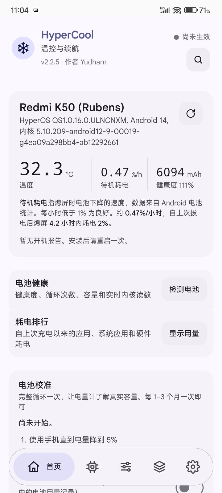 
      <b>首页</b>
    </td>
    <td align="center" valign="top">
      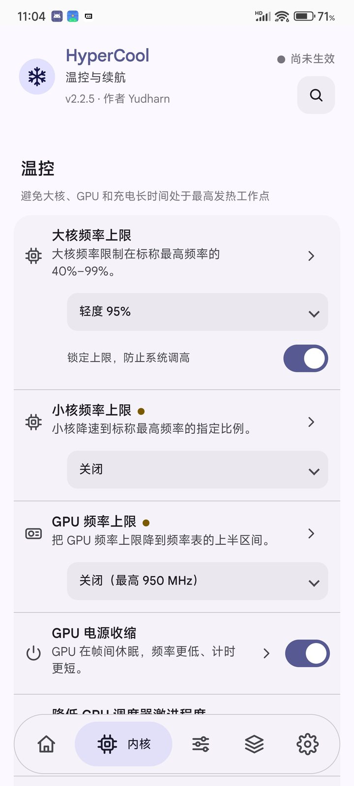 
      <b>温控</b>
    </td>
    <td align="center" valign="top">
      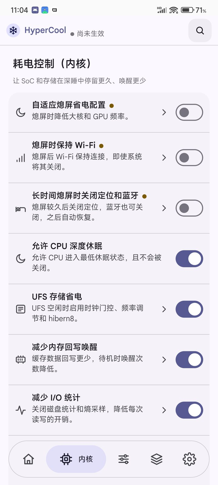 
      <b>耗电控制（内核）</b>
    </td>
  </tr>
  <tr>
    <td align="center" valign="top">
      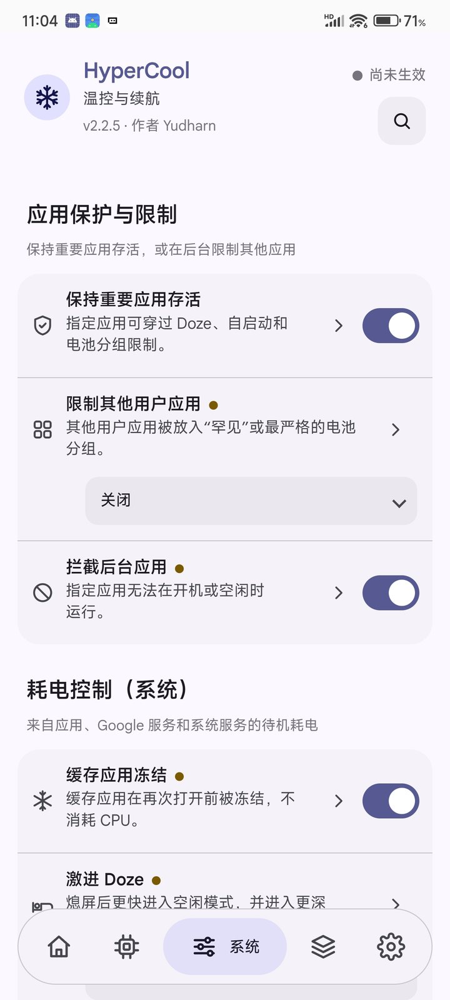 
      <b>应用保护</b>
    </td>
    <td align="center" valign="top">
      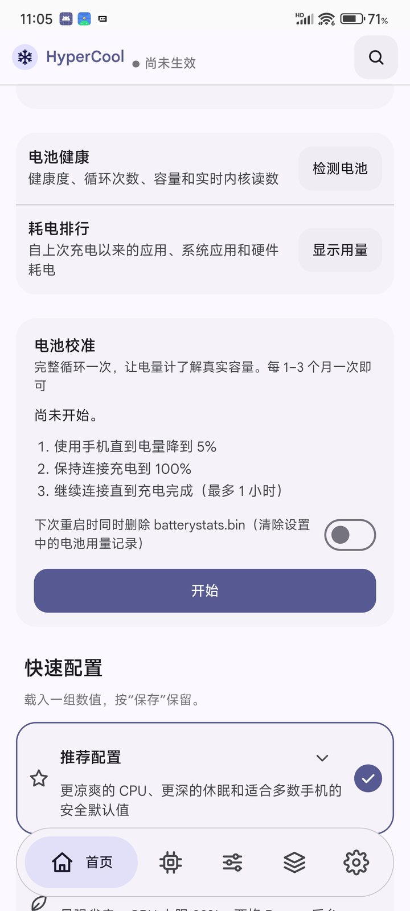 
      <b>电池校准</b>
    </td>
    <td align="center" valign="top">
      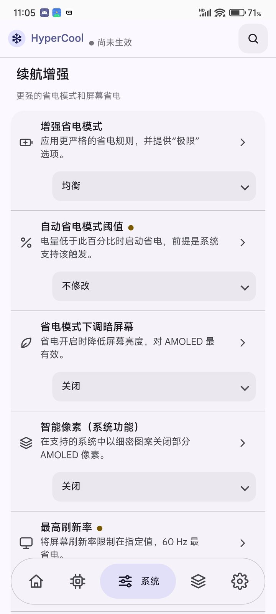 
      <b>续航增强</b>
    </td>
  </tr>
  <tr>
    <td align="center" valign="top">
      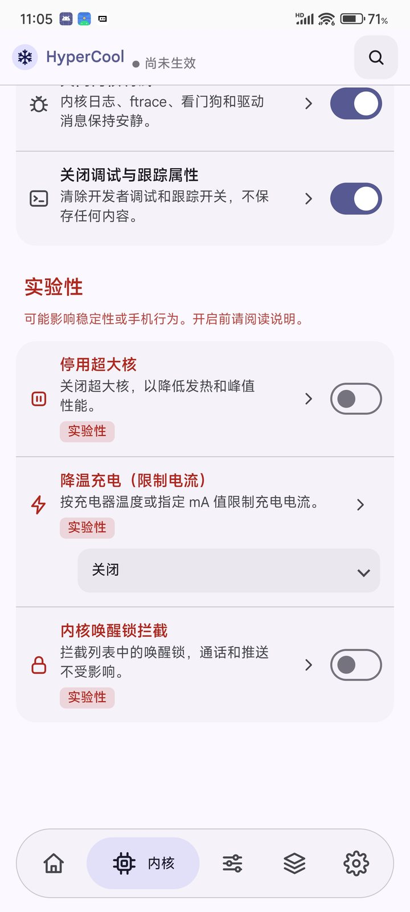 
      <b>高级</b>
    </td>
    <td align="center" valign="top">
      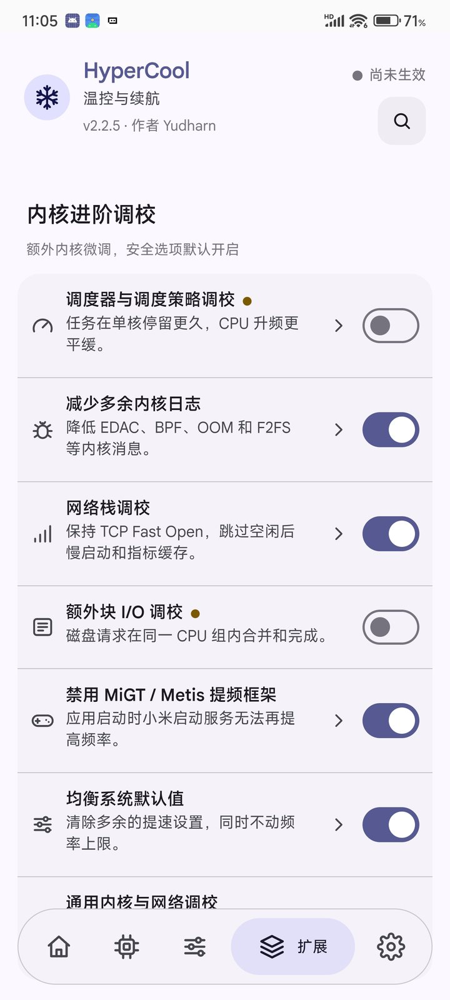 
      <b>内核进阶调校</b>
    </td>
    <td align="center" valign="top">
      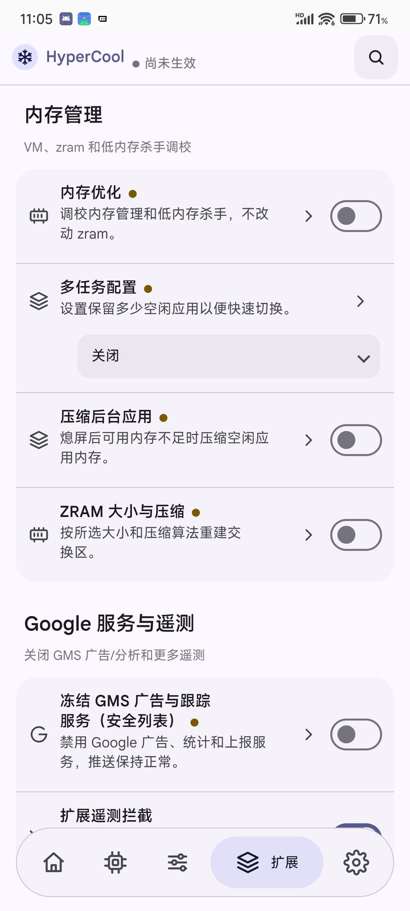 
      <b>内存管理</b>
    </td>
  </tr>
  <tr>
    <td align="center" valign="top">
      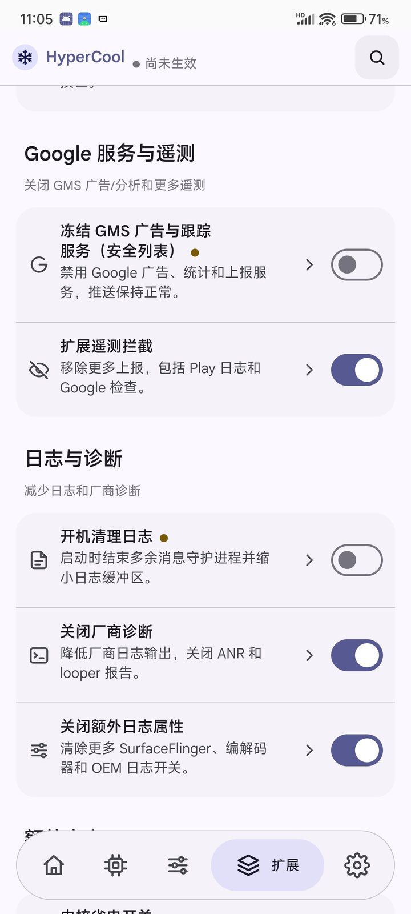 
      <b>Google 服务</b>
    </td>
    <td align="center" valign="top">
      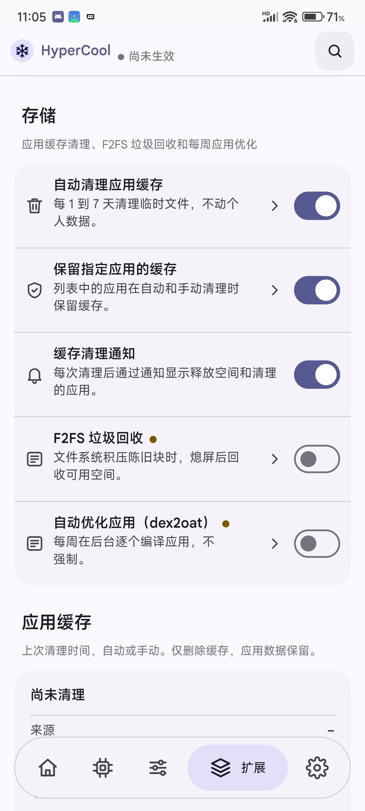 
      <b>存储</b>
    </td>
    <td align="center" valign="top">
      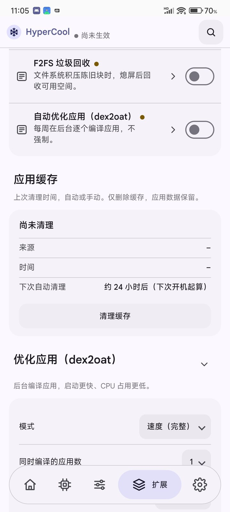 
      <b>应用缓存</b>
    </td>
  </tr>
  <tr>
    <td align="center" valign="top">
      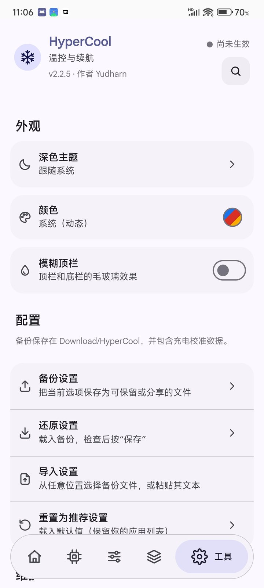 
      <b>工具</b>
    </td>
    <td align="center" valign="top">
      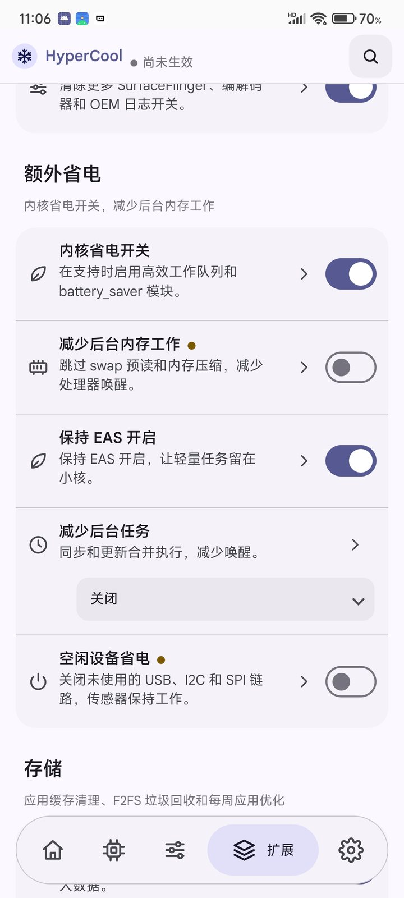 
      <b>额外省电</b>
    </td>
    <td align="center" valign="top">
      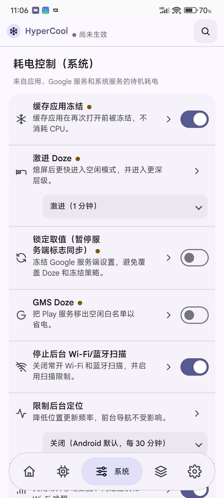 
      <b>耗电控制（系统）</b>
    </td>
  </tr>
</table>

## 功能

**温控**
- 大核频率上限（带锁定）
- 小核频率上限（默认关闭，带锁定）
- GPU 频率上限（来自本机 GPU 频率表，带锁定）
- GPU 电源收缩
- 降低 CPU 调度器激进程度（WALT / schedutil）
- 关闭内核触控提频
- 后台应用仅使用小核
- 停用超大核（Qualcomm；内核关闭 core_ctl 时自动开启，并验证核心确实已停用、锁定节点）
- CPU 守护：ROM 撤销限制时重新应用大/小核上限和超大核停用
- 关闭界面模糊
- 温度守护（实验性）：电池过热时降低大核上限和刷新率，降温后恢复
- 电池温度警告：电池过热时发送通知（默认关闭）
- 游戏省电模式：限制游戏帧率和渲染分辨率，降低发热（默认关闭）
- 暂停 / 旁路充电：过热、达到设定电量或游戏时暂停充电，改由充电器供电（默认关闭）
- 内存总线频率上限（Qualcomm，默认关闭）
- 更凉爽的充电（限流）

**耗电控制（内核）**
- 自适应熄屏省电配置
- CPU 深度休眠、UFS 省电
- 减少回写唤醒、减少 I/O 统计
- 关闭内核调试、内核唤醒锁拦截
- 熄屏期间保持 Wi-Fi（ROM 关闭后自动重开；你手动关闭的 Wi-Fi 保持关闭）
- 长时间熄屏后关闭定位和蓝牙（亮屏后恢复；默认关闭）
- 熄屏时执行 F2FS 垃圾回收（存储；回收只有 GC 能释放的空间；最多每周一次，无需充电；默认关闭）
- 熄屏时每周自动优化应用（dex2oat）（存储；speed-profile，不强制重新编译，完成后通知；默认关闭）
- 耗电排行（首页；只读：用户应用、系统应用、系统服务和硬件，数据来自 Android 电池统计）
- 电池历史：保存 48 小时电量、温度和屏幕状态，供首页图表使用（默认关闭）

**应用**
- 保持重要应用存活
- 限制其他用户应用
- 阻止应用后台运行
- 禁用应用（请谨慎选择）
- 残留应用文件夹：查找并删除已卸载应用留下的 Android/data 和 Android/obb 文件夹

**耗电控制（系统）**
- 缓存应用冻结、强力 Doze、GMS Doze
- 关闭 Wi-Fi/蓝牙扫描、限制后台定位、网络待机省电
- 应用待机、减少统计、关闭遥测
- 禁用分析和广告包、关闭 Joyose、减少日志
- 后台应用休眠（默认关闭）：熄屏几分钟后停止后台应用，受保护、使用中、充电等应用跳过
- 熄屏耗电检查与高耗电通知（默认关闭）
- 熄屏一段时间后关闭移动数据和 NFC，亮屏自动恢复（默认关闭）

**续航增强**
- 更强的省电模式、自动省电档位
- 省电模式下降低屏幕亮度、Smart Pixels（支持的系统）
- 刷新率上限、自适应刷新率（触控时高、空闲时低）、动画缩放
- 降低屏幕分辨率：整个系统以 90/80/75% 分辨率绘制（默认关闭）

**扩展**
- 调度器、网络（含更快的 TCP）和 I/O 调校
- 关闭 MiGT / Metis（小米）
- 均衡系统默认值、通用内核调校
- 内存优化、多任务配置
- ZRAM 大小与压缩（2-8 GB，或自定义最高 12 GB）
- 冻结 GMS 广告/分析、关闭更多遥测
- 清理日志、关闭厂商诊断
- 内核省电开关、能量感知调度器（含 C-state 感知）
- 空闲 USB / I2C / SPI 设备省电（需手动开启）
- 减少后台任务：JobScheduler 将后台工作批量推迟 1-2 小时（均衡 / 强力，会回读，ROM 忽略时恢复原值）
- 压缩后台应用：熄屏后且可用内存较低时压缩后台应用内存
- 自动清理应用缓存（每 1-7 天）、保留缓存的应用白名单、缓存清理通知
- 优化应用（dex2oat）：为所有应用提供实时进度（扩展页，按需运行）
- 全部应用完成后发送开机通知

**工具**
- 黑白单色外观（唯一外观），强调色可选系统动态或预设
- 深色 / AMOLED / 浅色 / 跟随系统、模糊顶栏
- 点按“未保存更改”可逐项查看改动前后对比
- HyperCool（冰川）强调色；更新后显示“新内容”摘要
- 备份、还原、导入设置，开机日志，错误报告，立即还原，重启

**首页**
- 最近活动与守护进程状态：查看后台守护进程的运行状态、最近操作和每日待机耗电
- 唤醒来源：内核唤醒统计，按唤醒时间或次数排序，可标记起点
- 当前 CPU 使用：测量最近 2 秒内最忙的进程
- 熄屏耗电检查：记录熄屏 30 分钟以上的耗电，高耗电时通知并指出唤醒应用（默认关闭）
- 立即休眠应用：手动停止后台应用，可选择停止应用或仅关闭后台进程
- 电池历史：查看 48 小时电量、温度和亮屏/熄屏耗电图表，可导出 CSV
- 残留应用文件夹：查找并删除已卸载应用留下的 Android/data 和 Android/obb 文件夹
- 搜索：按名称查找任意功能并跳转
- 待机耗电：自上次拔出充电器以来熄屏时每小时的耗电（下降 1% 后显示）
- 电池检测：健康度、容量、循环次数、温度等
- 电池校准：引导完成一次完整循环（5% → 100% → 直到充电完成），让电量百分比更准确（可选同时删除 batterystats.bin）

每项功能都会显示它更改了什么，以及上次开机的执行结果。
关闭功能会恢复原始值。不支持的功能会被跳过。

## 要求
- Android 11+
- KernelSU、KernelSU Next 或 APatch（Magisk：使用 MMRL 或 KsuWebUI 打开 WebUI）
- 高通 或 联发科 SoC，任意 ROM

## 文件
- `/data/adb/hypercool/config.conf` 设置
- `/data/adb/hypercool/status.conf` 上次开机结果
- `/data/adb/hypercool/boot.log` 日志
- `sh /data/adb/hypercool/restore.sh --all` 手动恢复所有系统更改

## 致谢
- Frosty by Drsexo
- Power Saver Pro by @ShastikXD & @TempMeow（部分代码来自 @kveld9）
- Hyper Optimize by Tatsh
- Xtreme Battery Saver（DethByte64）、Universal GMS Doze、sysconfig-patcher

## 支持

> [!NOTE]
> 如果 HyperCool 对你有帮助，欢迎支持开发：
>
> 

其他支持方式：[SociaBuzz](https://sociabuzz.com/yudharn) · [QRIS](https://t.me/ArchivesModules/1476)

## 免责声明
HyperCool 会修改内核和系统设置。请自行承担风险；作者不对开机循环、数据丢失或设备损坏负责。
请先备份，出现异常时逐项关闭功能。本模块不提供任何担保（详见 GPL）。

## 许可证
GPL-3.0-or-later。版权所有 (C) 2026 Yudharn。参见 [LICENSE](LICENSE)。
修改版本必须继续使用 GPL-3.0、保持源码公开并保留此版权声明。
Google Sans 字体：SIL Open Font License（`webroot/GoogleSans-OFL.txt`）。
